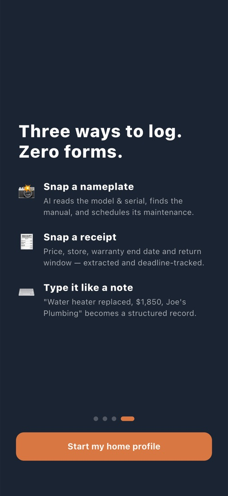
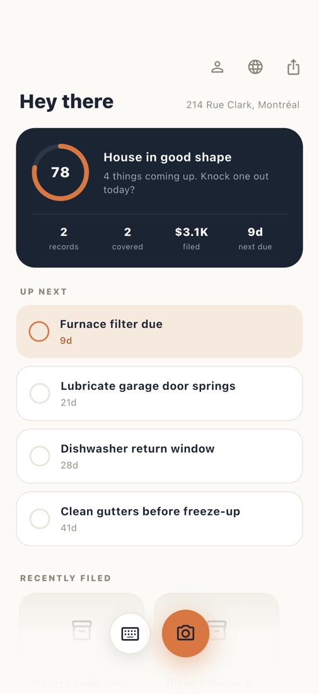
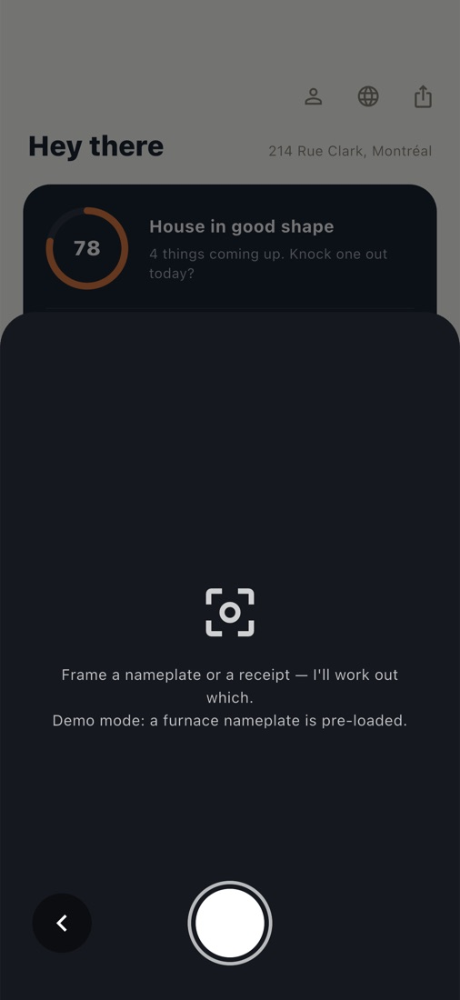
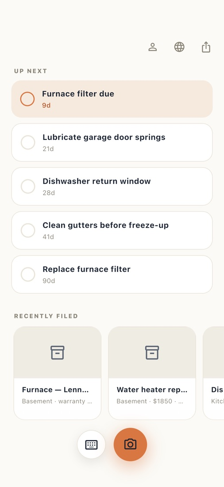
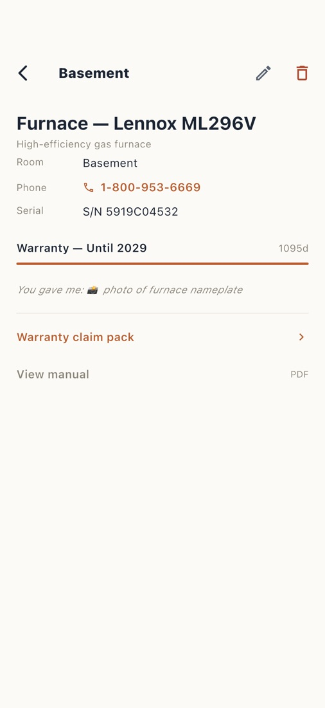
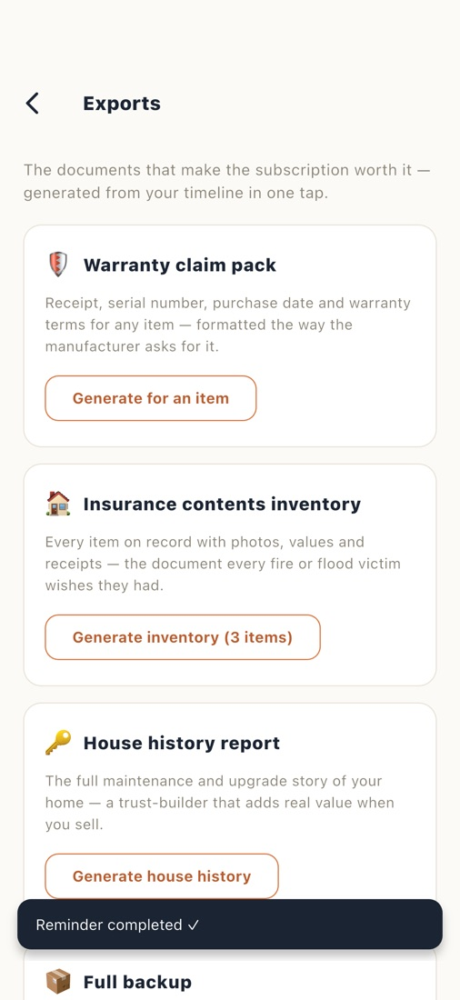
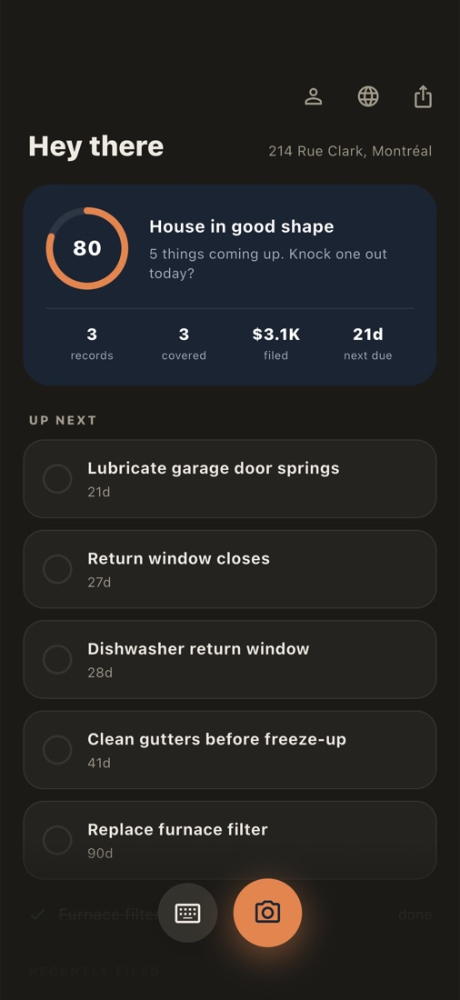
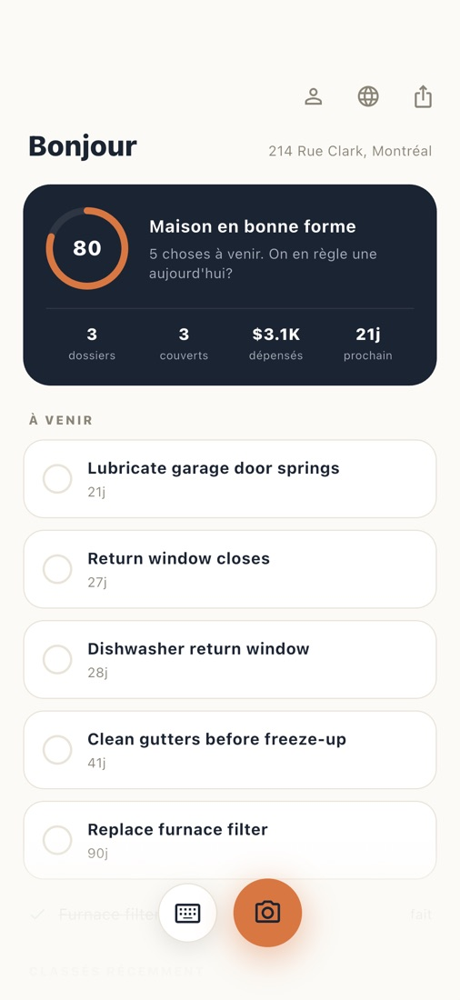

# Maison

[](https://github.com/davidazizmikhael/maison/actions/workflows/ci.yml)

The AI logbook for everything in your home. Snap a nameplate, a receipt, or
type a note — Maison structures it into your house's permanent record:
warranties, manuals, maintenance reminders, and exportable documents for
claims, insurance, and resale.

## Screenshots

| Onboarding | Home | Capture | Filed |
|:---:|:---:|:---:|:---:|
|  |  |  |  |

| Record | Exports | Dark mode | French |
|:---:|:---:|:---:|:---:|
|  |  |  |  |

## Stack

- **App:** Flutter (iOS-first), `lib/`
- **Backend:** Supabase (Postgres + auth + storage + edge functions), `supabase/`
  — see [BACKEND.md](BACKEND.md) for setup, deployment, and current status
- **AI:** a large language model called from the `parse-entry` edge function
  (falls back to demo parses until a provider key is configured, see
  [BACKEND.md](BACKEND.md))

## Run

Demo mode (no network, mock AI):

```bash
flutter run
```

Against the live backend — put the Supabase URL and publishable key in a local
`env.json` (git-ignored; copy `env.example.json` and fill it in from the
Supabase dashboard → Settings → API):

```bash
flutter run --dart-define-from-file=env.json
```

## Test

```bash
flutter test
```

Full UI walkthrough with screenshots (simulator must be booted):

```bash
flutter drive --driver=test_driver/integration_test.dart --target=integration_test/walkthrough_test.dart -d <device-id>
```

## Project docs

- [BACKEND.md](BACKEND.md) — Supabase setup, schema, edge function, secrets

## v1 scope (hold the line)

Nameplate scan + receipt scan + reminders + one export (warranty claim pack).
Nothing else ships in v1.
